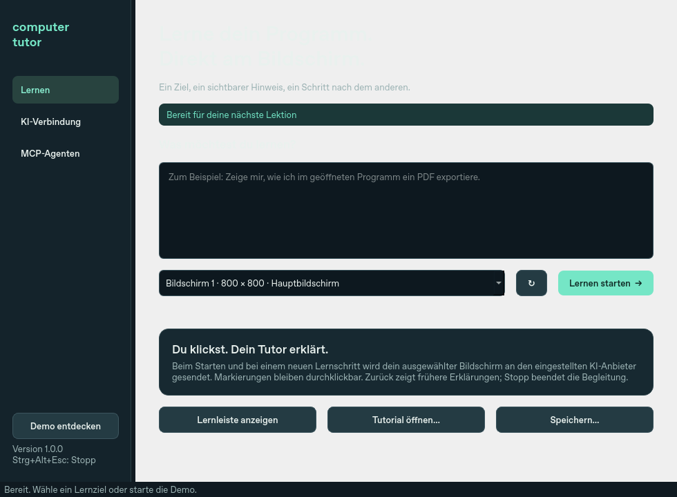
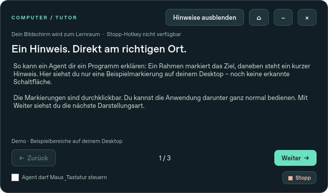

# Computer Tutor

**Eine Windows-App, die Programme direkt auf deinem Bildschirm erklärt.** Ein KI-Tutor
markiert Schaltflächen, schreibt Hinweise daneben und begleitet dich Schritt für Schritt.
Du kannst eine eigene KI-Verbindung einrichten oder einen vorhandenen MCP-Agenten verwenden.

[Windows-Download](https://github.com/interfurz/computer-tutor/releases/latest) ·
[Agenten-Leitfaden](docs/agent-guide.md) · [Architektur](docs/architecture.md)



## Installieren und loslegen

1. **ComputerTutor-Setup-1.0.0-x64.exe** aus den Releases herunterladen und installieren.
   Python und Administratorrechte sind nicht erforderlich.
2. **Computer Tutor** aus dem Startmenü öffnen. Über **Demo entdecken** kannst du das HUD
   sofort ausprobieren, ohne Zugangsdaten einzugeben.
3. Für den integrierten Tutor unter **KI-Verbindung** API-Adresse, ein Modell mit Bildfunktion
   und deinen eigenen API-Key eintragen. Bildschirmaufnahmen erlauben und speichern.
4. Unter **Lernen** ein Ziel eingeben, den Bildschirm auswählen und **Lernen starten** drücken.
5. Den gezeigten Schritt selbst ausführen. **Weiter** nimmt den Bildschirm neu auf und fragt
   nach dem nächsten Schritt. **Zurück** zeigt die bereits erstellten Erklärungen.

Die portable ZIP funktioniert ohne Installation: vollständig entpacken und **ComputerTutor.exe**
starten. Beide Varianten benötigen Windows 10 ab Version 2004 oder Windows 11, jeweils x64.

## Direkt am Ziel lernen



- Durchklickbare Rahmen, Spotlights und Textkarten direkt am Ziel.
- Ausführliche Erklärung und Zurück/Weiter in einer eigenen Lernleiste.
- Die Leiste weicht markierten Bereichen möglichst aus. Am Schriftzug ziehen zum Verschieben,
  doppelklicken zum Zurücksetzen, **−** zum Einklappen.
- **×** pausiert die Begleitung und blendet die Leiste aus. Über das Tray oder das Startfenster
  lässt sie sich wieder öffnen. **⌂** öffnet das Startfenster.
- **Stopp** oder **Strg+Alt+Esc** bricht die Begleitung ab, blendet Markierungen aus und sperrt
  Agenteneingaben. Ein bereits gesendeter API-Aufruf kann beim Anbieter noch zu Ende laufen;
  sein Ergebnis wird nach dem Stopp verworfen.
- Tutorials lassen sich als JSON speichern und wieder öffnen. Beim Import wird der aktuell
  gewählte Monitor verwendet. Bilder, Zugangsdaten und Eingabefreigaben werden nicht exportiert.

**Weiter ist kein Erfolgsbeweis.** Die KI soll anhand des neuen Bildes prüfen, ob die vorige
Handlung erledigt wurde. **Zurück** macht keine Änderungen in anderen Programmen rückgängig.
Ältere Schritte enthalten historische Markierungen; für einen veränderten Bildschirm einen
neuen Schritt erzeugen. Importierte Tutorials sind gespeicherte Erklärungen ohne laufende KI.

## Welche KI lässt sich verwenden?

Die App spricht eine **OpenAI-kompatible Chat-Completions-API** mit Bildinhalten und JSON-Modus
an. Standard: `https://api.openai.com/v1`, Modell `gpt-4.1-mini`. Es ist kein Modell und kein
API-Guthaben enthalten. Andere Anbieter benötigen ein kompatibles Vision-Modell; lokale
Anbieter auf `localhost` dürfen HTTP und einen leeren API-Key verwenden.

Der eingebaute Tutor erklärt; du bedienst das Programm selbst. Optionale Computersteuerung
steht externen MCP-Agenten über getrennte, lokal freizugebende Werkzeuge zur Verfügung.

## Vorhandene MCP-Agenten verbinden

Unter **MCP-Agenten** steht eine kopierbare Konfiguration mit dem richtigen Installationspfad:

```json
{
  "mcpServers": {
    "computer-tutor": {
      "command": "C:\\Users\\DEINNAME\\AppData\\Local\\Programs\\ComputerTutor\\computer-tutor-mcp.exe",
      "args": ["--mcp"]
    }
  }
}
```

Der MCP-Starter öffnet die App bei Bedarf und verwendet dieselbe laufende Instanz. Mehrere
Client-Verbindungen teilen sich das HUD; die zuletzt geladene Lektion ist sichtbar. Beim
Trennen oder Ausfall einer Verbindung wird die Eingabefreigabe zurückgenommen. Die App bleibt
für weitere Lektionen geöffnet. App über das Tray-Menü **Beenden** vollständig schließen.

Beispielauftrag:

> Erkläre mir, wie ich in meinem geöffneten Programm ein PDF exportiere. Nutze Computer Tutor.
> Schau zuerst auf den Bildschirm, markiere das richtige Ziel und lass mich selbst klicken.
> Prüfe den Bildschirm nach Änderungen erneut.

| Werkzeuge | Zweck |
| --- | --- |
| `tutor_list_monitors`, `tutor_capture_screen` | Bildschirme und eine HUD-freie Aufnahme |
| `tutor_present_tutorial`, `tutor_update_step` | Lernschritte und Markierungen setzen |
| `tutor_get_state`, `tutor_navigate` | Zustand lesen, Erklärungen wechseln |
| `tutor_set_annotations_visible`, `tutor_stop` | Hinweise ausblenden, Eingaben sperren |
| `desktop_click`, `desktop_type_text` | Maus und Unicode-Texteingaben |
| `desktop_hotkey`, `desktop_scroll` | Tastenkombinationen und Mausrad |

Nur der Schalter in der Lernleiste erlaubt Eingaben. Ein Agent kann sich die Freigabe nicht
selbst geben. Klicken auf die eigenen App-Fenster und Tastatureingaben bei deren Fokus sind
gesperrt. Server, App und Zielprogramme müssen auf demselben Windows-Desktop laufen; ein
Linux-/WSL-MCP-Prozess erhält dadurch keinen Zugriff auf den Windows-Desktop.

## Deine Daten

- Direkter Tutor: Nur nach deiner Freigabe und einem Lernstart/neuen Schritt geht eine Aufnahme
  des ausgewählten Monitors an den eingestellten Anbieter. Dessen Konditionen und API-Kosten gelten.
- MCP: Screenshots werden auf Werkzeugaufruf an den verbundenen Client übergeben.
- Die App speichert Screenshots weder auf der Festplatte noch in einer eigenen Cloud.
- API-Key und lokaler Verbindungsschlüssel sind mit Windows DPAPI für dein Benutzerkonto geschützt.
- Einstellungen und begrenzte Fehlerlogs liegen unter `%LOCALAPPDATA%\ComputerTutor`.
- Die App öffnet keinen HTTP-Port. GUI und MCP-Starter sprechen über eine authentifizierte lokale
  Windows Named Pipe. Es gibt keine Telemetrie.
- Eine Deinstallation lässt persönliche Einstellungen bestehen. Vorher über **API-Key entfernen**
  den Schlüssel löschen oder den genannten Datenordner anschließend selbst entfernen.

## Grenzen und Prüfstand

Markierungen beziehen sich auf einen Monitor und Bildschirmkoordinaten. Sie folgen noch keinen
Windows-UI-Automation-Elementen. Nach Verschieben, Scrollen oder Menüwechseln braucht es eine neue
Aufnahme. Display-/Skalierungsänderungen verwerfen alte Lektionen und sperren Eingaben.

UAC, Sperrbildschirm, geschützte Inhalte und die Steuerung erhöhter Anwendungen werden nicht
unterstützt. KI-Ziele können falsch erkannt werden; die Freigabe von Eingaben ist keine Sandbox
für Aktionen im Zielprogramm. Viele dicht beieinanderliegende Karten können überlappen.

Die CI prüft Linux und Windows, die DPAPI-Verschlüsselung, den gebauten MCP-Starter, die gemeinsame
GUI-Instanz und Installation/Start/Deinstallation. KI-Protokoll und Fehler werden mit kontrollierten
HTTP-Antworten getestet; ohne bereitgestellten API-Key wird kein kostenpflichtiger Live-Aufruf
getestet. Die interaktive Abnahme auf echten Desktops mit gemischter DPI-Skalierung bleibt im
[manuellen Prüfplan](docs/windows-validation.md) dokumentiert.

## Entwickeln und selbst bauen

```powershell
git clone https://github.com/interfurz/computer-tutor.git
cd computer-tutor
uv sync --locked --extra dev --extra build
uv run computer-tutor
uv run pytest -q
uv run ruff check .
uv run pyinstaller --noconfirm --clean packaging/computer-tutor.spec
```

Ergebnis: `dist/ComputerTutor/ComputerTutor.exe` und `computer-tutor-mcp.exe` mit gemeinsamem
`_internal`-Ordner. Den gesamten Ordner verteilen. Für den Installer anschließend
`ISCC.exe packaging/installer.iss` mit installiertem Inno Setup 6 oder neuer aufrufen.

Ohne uv: `py -3 -m venv .venv`, danach `.venv\Scripts\python.exe -m pip install -e ".[dev,build]"`.
Unter Linux: `QT_QPA_PLATFORM=offscreen uv run pytest`; `--allow-non-windows` ist nur ein
Entwicklungsschalter. Native Eingaben und sichere Zugangsdaten benötigen Windows.
