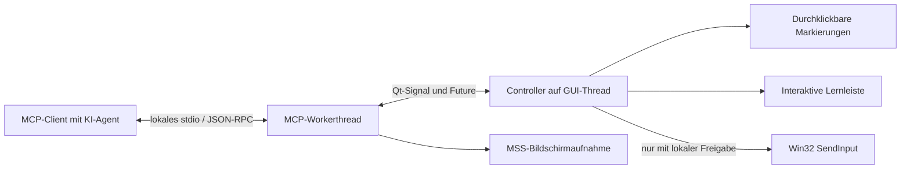

# Architektur

Ein Prozess besitzt beide Fenster und den MCP-Server. Es gibt keinen offenen
Netzwerkport und keine zweite, dauerhaft laufende Hintergrundkomponente.

`models.py` definiert validierte Tutorials und den Navigationszustand. `ui.py`
zeichnet die transparenten Markierungen und die bedienbare Lernleiste getrennt:
Die Markierungsebene hat `WindowTransparentForInput` und nimmt keinen Fokus an.

`controller.py` ist die einzige Autorität für Zustand und Eingabefreigabe. MCP-Tools
rufen ihn über `GuiBridge` auf dem Qt-Hauptthread auf. Ein abgelaufener, noch nicht
gestarteter Auftrag wird verworfen, damit verspätete Klicks nicht überraschend
ausgeführt werden. Native Eingaben sind kurz und begrenzt, nicht als lang laufende
Makros implementiert. Der globale Stopp wirkt nach einer gerade laufenden kurzen
Eingabe, nicht als Unterbrechung bereits an Windows übergebener Ereignisse.

`server.py` stellt die stdio-Werkzeuge bereit. Screenshot-Aufnahmen werden
serialisiert. Der Controller versteckt beide Fenster, der Worker wartet kurz auf
den Compositor, nimmt über MSS auf und stellt das HUD in einem `finally`-Block wieder
her. Das kurze Ausblenden kann sichtbar sein. Display-Änderungen während der Aufnahme
führen zu einem Fehler statt zu einem veralteten Koordinatenbezug.

## Koordinaten und DPI

Das öffentliche Protokoll verwendet relative Koordinaten im Bereich 0 bis 1 auf
**einem ausgewählten Monitor**. Ein Rechteck muss vollständig darin liegen.

- Screenshots verwenden die über Win32 ermittelte physische Monitorgeometrie.
- Qt zeichnet in der logischen Geometrie des zugehörigen `QScreen`.
- `QScreen.name()` wird mit dem Win32-Display-Gerätenamen abgeglichen.
- Klicks werden in physische Pixel umgerechnet; der rechte/untere Rand wird auf
  den letzten Pixel begrenzt.
- Bei fehlender Zuordnung sind Capture und Klicks gesperrt.
- Bei einer Displayänderung wird die alte Lektion verworfen und die Steuerung gesperrt.

Die Windows-Build-Manifestdatei setzt Per-Monitor-V2-DPI-Awareness. Die manuelle
Validierung von mehreren Monitoren, negativen Ursprüngen und DPI-Mischungen bleibt
ein notwendiger Abnahmeschritt.

## Prozess-Lebenszyklus

Ohne Argumente bzw. mit `--demo` startet eine lokale Demo. Mit `--mcp` startet der
Client den stdio-Worker plus HUD. EOF vom Client schließt Qt. Lokales Schließen
beendet nach Qt-Cleanup den dedizierten Prozess, auch wenn der stdio-Reader noch auf
Eingaben wartet. stdout ist für JSON-RPC reserviert, Logs gehen nach stderr.
