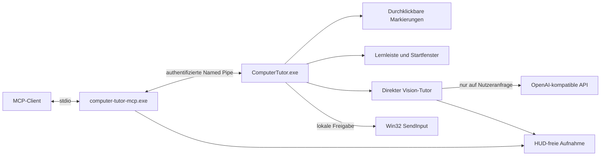

# Architektur 1.0

## Lebenszyklus und IPC

Die sichtbare App hält eine `QLockFile` pro Datenverzeichnis. Ein erneuter Start öffnet dieselbe
Instanz. Der MCP-Starter kann die GUI ohne Konsole starten und blockiert stdio ausschließlich
für MCP. Named-Pipe-Anfragen verwenden JSON statt Pickle und einen zufälligen, mit DPAPI
verschlüsselten Authentifizierungsschlüssel. Eine feste Methodenliste enthält keine Möglichkeit,
die lokale Eingabefreigabe einzuschalten. Unter Linux verwenden Entwicklungstests Unix-Sockets.

`GuiBridge` serialisiert Requests auf den Qt-Hauptthread. Abgelaufene, noch nicht begonnene
Aufträge werden verworfen. Client-Heartbeats laufen alle drei Sekunden; nach zwölf Sekunden ohne
Heartbeat sperrt die GUI Eingaben. Eine normale Trennung sperrt sie sofort. GUI und Daten bleiben
nach einer Trennung geöffnet. Die lokale App hat ihr eigenes Tray-Menü zum Beenden.

## Direkte KI

`LessonAgent` nimmt nur auf ausdrücklichen Lernstart oder Anforderung eines neuen Schritts ein
Bild auf. Einstellungen und API-Key werden für die Anfrage kopiert. Der HTTP-Aufruf läuft in
einem Worker mit Zeitlimits. Abbruchmarkierungen und Request-Identität verhindern, dass verspätete
Antworten ein anderes Tutorial überschreiben. Es gibt keine automatische Dauerbeobachtung.

Das Modell erhält Lernziel, höchstens acht bisherige Schritte und das aktuelle Bild. Seine
JSON-Antwort wird vollständig mit dem Pydantic-Datenmodell validiert, einschließlich eindeutiger
IDs und im Monitor liegender Zielrechtecke. Ungültige Antworten erzeugen eine wiederholbare
Fehlermeldung. Der direkte Tutor verfügt über keine Eingabewerkzeuge.

## Capture und DPI

Öffentliche Koordinaten sind monitor-relative Werte von 0 bis 1. Qt zeichnet in logischen
Koordinaten; Win32-Monitorrechtecke liefern die physischen Pixel für MSS und Eingaben.
`QScreen.name()` wird mit dem Windows-Displaynamen abgeglichen. Bei fehlender Zuordnung sind
Capture und Klicks gesperrt. Das Manifest verwendet Per-Monitor-V2-DPI-Awareness.

Vor einer Aufnahme versteckt der Controller alle sichtbaren App-Fenster. Capture-Leases zählen
parallele Aufnahmen; erst nach der letzten erscheinen die Fenster wieder. Ein abgestürzter
MCP-Starter kann das HUD nicht unbegrenzt verstecken: verwaiste Leases laufen nach zehn Sekunden
ab. Ein abgelaufener oder bei Displayänderung inkonsistenter Screenshot wird verworfen.

## Speicherung und Distribution

Windows DPAPI schützt den API-Key für den aktuellen Benutzer. Einstellungen werden atomar ersetzt.
Es gibt keine Screen-Aufzeichnungen oder automatische Tutorial-Persistenz. Exportierte JSON-Dateien
enthalten nur Tutorialtexte und Markierungen. Rotierende lokale Fehlerlogs sind begrenzt.

PyInstaller baut einen GUI- und einen Konsolenstarter mit gemeinsamem Laufzeitordner. Inno Setup
installiert pro Benutzer ohne erhöhte Rechte. Die CI prüft auch die gebauten Programme und führt
eine stille Installation, einen GUI-Starttest und eine Deinstallation aus.
